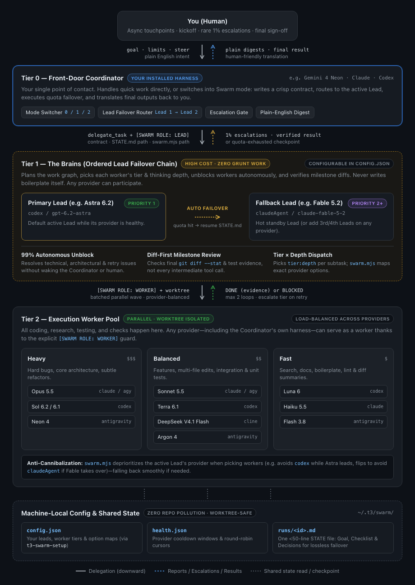

# t3-swarm

A lightweight, **three-tier multi-provider orchestration skill** for [T3 Code](https://t3.codes) — designed to give you a single, natural-language point of contact while routing planning, failover, and parallel execution across your enabled AI providers without falling into coordination hell.

- **Tier 0 — Coordinator:** Your single point of contact. Translates intent into crisp contracts, handles quota failover, and reports results in plain English.
- **Tier 1 — The Brains (Ordered Lead Failover Chain):** High-judgment models (e.g. Astra 6.2 → Fable 5.2) that plan, assign worker tiers, unblock 99% of technical issues autonomously, and review milestone diffs—never wasting flagship quota on grunt work.
- **Tier 2 — Execution Worker Pool:** Parallel, worktree-isolated workers grouped into **Heavy / Balanced / Fast** tiers and spread across your billing buckets in proportion to how much quota each one has.

Compatible with **`npx skills`** (`skills/<name>/SKILL.md`) and **Antigravity Plugins** (`plugin.json`).

---

## Architecture



## Operating Modes & Anti-Coordination-Hell

Swarms fail when they wrap a 2-minute bug fix in 15 minutes of planning bureaucracy. `t3-swarm` defaults to **zero overhead** and lets you move cleanly between three modes mid-session:


---

## Installation

> [!IMPORTANT]
> **Install this skill ONLY on the single harness/provider you want as your Coordinator** (for example, Antigravity, Claude Code, Codex, or OMP/Pi).
>
> **Why `--copy` matters for Antigravity & Claude Code:** Default `npx skills -g` symlink mode stores a canonical copy in `~/.agents/skills/` (which Codex, Cline, and Pi scan globally). Using `--copy` keeps the skill strictly inside your chosen Coordinator's directory. On harnesses that natively read `~/.agents/skills/` (Codex, Pi/OMP, Cline), the `[SWARM ROLE: ...]` guard protects child sessions automatically.

### Install with `npx skills` (Recommended)

```bash
# Example: Use Antigravity as your Coordinator (e.g. Gemini 4 Neon)
npx skills@latest add mochahub/t3-swarm -g -a antigravity --copy

# Example: Use Claude Code as your Coordinator
npx skills@latest add mochahub/t3-swarm -g -a claude-code --copy

# Example: Use Codex as your Coordinator
npx skills@latest add mochahub/t3-swarm -g -a codex

# Example: Use OMP / Pi as your Coordinator
npx skills@latest add mochahub/t3-swarm -g -a pi
```

This installs both skills from the repository:
1. **`t3-swarm`** — the main runtime Coordinator skill + zero-dependency `swarm.mjs` router CLI
2. **`t3-swarm-setup`** — interactive auto-discovery & setup wizard

### Install as an Antigravity Plugin (Alternative — Do Not Combine With `npx skills`)

If you use Antigravity and also want the lightweight always-on trigger rule (`rules/AGENTS.md`) that nudges your Coordinator to offer Mode 2 mid-session when a chat grows complex, clone directly into Antigravity's global plugins directory (use **either** the plugin **or** `npx skills`, not both, to avoid loading duplicate skills):

```bash
git clone https://github.com/mochahub/t3-swarm.git ~/.gemini/config/plugins/t3-swarm
```

*(If registering via `~/.gemini/config/plugins.json` instead, remember Antigravity scans `entries[].path` one level deep—point `path` to the parent directory containing `t3-swarm/`.)*

### Multi-Provider Harnesses (OMP / Pi, OpenCode, Cline)

When a single T3 `providerInstanceId` hosts models from multiple upstream vendors (e.g. **OMP / Pi** with `openai/...`, `anthropic/...`, `google/...`, or **Cline** with `provider: "cline"` credits vs `provider: "openai-codex"`), `swarm.mjs` separates **T3 harness (`provider`)** from **quota bucket (`bucket`)**:

Bucket resolution order:
1. Explicit per-entry `bucket`
2. Upstream `staticOptions.provider` mapped via `bucketAliases` (e.g. Cline `openai-codex` → `codex`, sharing cooldowns & anti-cannibalization with T3 Codex!)
3. Provider-level shared `bucket` (e.g. `providers.acpRegistry_cline.bucket = "cline-pass"` keeps all Cline Pass models in one bucket)
4. Namespaced vendor prefix (`${provider}:${vendor}`, e.g. `pi:openai`, `pi:anthropic`) so separate harnesses never collide accidentally
5. Fallback to `provider`

```json
{
  "providers": {
    "pi": {
      "depthOption": "effort",
      "depthMap": { "low": "low", "medium": "medium", "high": "high", "deep": "xhigh" }
    }
  },
  "leads": [
    { "provider": "pi", "bucket": "pi:openai", "model": "openai/gpt-6.2-astra" },
    { "provider": "pi", "bucket": "pi:anthropic", "model": "anthropic/claude-fable-5-2" }
  ]
}
```

### Quota weights: send more work to your biggest plans

If your subscriptions differ in size, tell the router. Each billing bucket gets worker tasks in proportion to its weight:

```json
{
  "weights": {
    "buckets": { "claudeAgent": 10, "codex": 5, "antigravity": 1, "cline-pass": 0.5 },
    "leadBucketMultiplier": 0.5,
    "leadSelection": "weighted"
  },
  "leads": [
    { "provider": "codex",       "model": "gpt-6.2-astra",    "weight": 2 },
    { "provider": "claudeAgent", "model": "claude-fable-5-2", "weight": 1 },
    { "provider": "antigravity", "model": "gemini-4-argon",   "weight": 0 }
  ]
}
```

- **Workers** are picked by smooth weighted round-robin (the nginx algorithm): deterministic, and evenly interleaved rather than bursty. With the weights above, balanced-tier tasks come out at about Claude 61%, Codex 30%, Gemini 6%, Cline 3%.
- **A bucket's weight is shared by its models within a tier**, so listing two Claude models in one tier doesn't double Claude's share. A per-model `"weight"` overrides its bucket for that one tier entry.
- **The Lead's own bucket is scaled, not excluded:** `leadBucketMultiplier` (default `0.5`) applies to `--avoid` buckets. Under a Claude Lead the example becomes Claude and Codex about 43% each, Gemini 9%, Cline 4%.
- **Weight `0` means "only when nothing else is available"**: for workers, and for leads it means failover-only.
- **Leads:** `"priority"` (default) always takes the first healthy lead in list order. `"weighted"` rotates leads across runs by their `weight` (the example: Astra leads 2 runs in 3, Fable 1, Argon only if both are out). `pick-lead --run <run-id>` keeps a run's Lead fixed, so calling it again never changes it.
- **Optional `maxSessionsPerBucket`** caps live sessions on one bucket in a wave, the Lead's included. Waves no longer have to use a different bucket per worker, so set it to `2` if you want that spread back; `3` caps concurrency with little effect on shares.
- Weights balance the **number of tasks**, not tokens: a Lead session or an Opus task uses far more quota than a Haiku task. When a big bucket is in cooldown, part of its share moves to the others.
- `doctor` prints every entry's weight and rejects weight keys that match no configured bucket, so a typo can't silently leave a bucket at weight 1.

### Periodic status updates (optional)

For long Mode 2 runs, you can have the Coordinator post automatic progress updates and a rough ETA on a T3 interval schedule (off by default):

```json
{
  "statusUpdates": {
    "enabled": true,
    "intervalMinutes": 15
  }
}
```

- When enabled (or when you ask for periodic updates on a single run), the Coordinator creates a thread-bound T3 `schedule_task` right after launching the Lead and deletes it as soon as the run finishes, escalates, or is cancelled.
- **Zero extra process on the Lead or workers:** On each tick, the Coordinator reads `STATE.md` and `t3_thread_read` on the active Lead thread (plus `t3_thread_list` for worker running/completed counts when needed) without interrupting a busy Lead or burning flagship Lead quota. Short runs that finish before the first interval never trigger an update at all.
- Never used in Mode 1, and ignored in repo `.t3-swarm.json` overrides.

### Can my Coordinator's provider ALSO be a Lead or Worker?

**Yes!** Installing `t3-swarm` on Antigravity (or Claude Code, Codex, or OMP) does **not** lock that harness into Tier 0 only.

Every delegated Lead prompt has a standalone line `[SWARM ROLE: LEAD]` at line 1 and every Worker prompt has `[SWARM ROLE: WORKER]` at line 1. Both `SKILL.md` files and `rules/AGENTS.md` check whether the prompt contains either standalone line (accounting for T3's own metadata header above delegated prompts) and immediately ignore Coordinator behavior if present.

---

## Quickstart

### 1. Auto-configure from your enabled T3 providers

Open a thread on your Coordinator harness in T3 Code and say:

> *"Set up t3-swarm"*

The `t3-swarm-setup` skill calls T3's `orchestrator_capabilities` (using `search` when models are omitted), asks how any multi-provider harnesses are billed, proposes a Lead failover chain and Heavy / Balanced / Fast worker tiers, writes `~/.t3/swarm/config.json`, and runs `swarm.mjs doctor` to verify every resolved bucket and option map.

*(If you forget this step and immediately ask to use the swarm, `t3-swarm` detects the missing config and hands off to `t3-swarm-setup` automatically.)*

### 2. Use it naturally

- **Mode 0 (Default):** Just chat normally. Quick questions and 1-turn edits stay direct—zero swarm overhead.
- **Mode 1 (Light):** *"Delegate fixing the auth token refresh test to a worker."* → Coordinator picks `tier:depth`, routes to one load-balanced worker, verifies its diff/tests, and skips the Lead and ledger.
- **Mode 2 (Full Swarm):** *"Use the swarm to build the billing webhook pipeline with tests and docs."* → Coordinator creates a `<50`-line `STATE.md`, isolates work on a `swarm/<runId>` branch/worktree, dispatches your Priority 1 Lead, handles mid-session failover if quota runs out, and delivers a plain-English summary.
- **Mid-session switch:** When a normal chat grows multi-track, your Coordinator asks in one line if you want to escalate to swarm mode. Say *"drop back to direct"* anytime to step down.
- **Manual quota hint:** Notice a provider running low in T3? Just say *"Codex is almost out, lead with Fable"*—the Coordinator marks a cooldown on that bucket and routes cleanly without waiting for a rate-limit error.

### Built-in guardrails

- **Cooldowns are scoped to what ran out.** A key can be a whole bucket (`codex`), one model (`claudeAgent:claude-fable-5-2`), or a quoted glob (`'antigravity:claude-*'`). One model's weekly cap no longer hides its healthy siblings. `cooldown` prints every model it blocks and warns when no Lead is left.
- **Reset times are honored.** Pass the time from the error (`1h42m`, `7d`, or `--until <ISO time>`) instead of a fixed 60 minutes.
- **The Lead chain can't run dry silently.** When every configured lead is cooling down, `pick-lead` falls back to the heavy worker pool.
- **Verify narrowly, gate once.** Parallel workers run only targeted checks; the Lead runs the full gate once, on the integrated branch. Several full suites at once contend for the same CPU, so each one runs slower than one would alone.
- **No early returns.** Workers and Leads run verification in the foreground, because ending a turn is the return. The Coordinator never touches a Lead's worktree before `STATUS: COMPLETE`, and `finish` refuses to archive a run whose ledger doesn't say `Status: COMPLETE`.
- **Reviews go through the router**, run in the shared checkout, and append findings to a file as they go, so a quota cutoff never loses them.
- **Compaction-resilient across all tiers.** `STATE.md` carries a `Runtime` line (`script`, `leadBrief`, `workerBrief`, worktree/loop caps) so a compacted Lead recovers its full contract and paths in two reads; workers check `git status`/`git diff` instead of redoing edits; and Role Guards match both literal `[SWARM ROLE: ...]` tags and compacted role summaries.

---

## Configuration & State (`~/.t3/swarm/`)

User configuration and runtime state live outside the installed skill so updates never overwrite your setup:

```text
~/.t3/swarm/
├── config.json          # Your Lead priority list, Worker tiers, billing buckets & option maps
├── health.json          # Locked, atomic cooldown windows, weighted round-robin credits & per-run Lead picks
├── hooks.mjs            # Optional: export async function checkQuota(provider, model, bucket)
├── runs/<run-id>.md     # Single-file STATE.md per active Mode 2 run
└── archive/             # Archived runs after `swarm.mjs finish <run-id>`
```

- **Safe project overrides (opt-in):** By default, `.t3-swarm.json` in cloned repositories is **ignored** so untrusted repos cannot inject expensive options (`ultracode`, `ultrathink`, `auto_approve`). Set `"allowProjectOverride": true` in `~/.t3/swarm/config.json` to let trusted repos override `leads`/`workers` ordering (only for providers already defined in your global config; `staticOptions` and `providers` overrides are always stripped). Commit `.t3-swarm.json` if you want git worktrees to see it.
- **Custom quota hooks:** Create `~/.t3/swarm/hooks.mjs` exporting `async function checkQuota(provider, model, bucket) { return { available: true }; }`—it survives skill upgrades automatically.

See [`skills/t3-swarm/references/config.example.json`](skills/t3-swarm/references/config.example.json) for a complete multi-provider example.

---

## Router CLI (`swarm.mjs`)

`swarm.mjs` has zero external dependencies (Node 18+). Run `doctor` to see the exact `scriptPath` for your install:

```bash
SCRIPT="<scriptPath-from-doctor>"

# Validate config, resolved billing buckets, and ~/.t3/swarm write access
node "$SCRIPT" doctor

# Show Lead priority status, resolved buckets, active cooldowns, and recent runs
node "$SCRIPT" status

# Initialize a single-file STATE.md for a Mode 2 run (records git base + integration branch)
node "$SCRIPT" init "billing-webhooks" --goal "Add Stripe webhook handler + tests"

# Pick the Lead for a run (sticks to the run; falls back to the heavy worker pool if every lead is out)
node "$SCRIPT" pick-lead --depth high --run <run-id>

# Pick one worker by quota weight (Mode 1)
node "$SCRIPT" pick-worker balanced:medium

# Pick a parallel wave of workers in one call, weighting the active Lead's bucket down (Mode 2)
node "$SCRIPT" pick-workers heavy:high balanced:medium fast:low --avoid codex

# Mark a cooldown (1 minute to 7 days), scoped to what actually ran out
node "$SCRIPT" cooldown codex --until 2026-11-24T08:00:00Z --reason "plan limit"   # whole bucket
node "$SCRIPT" cooldown claudeAgent:claude-fable-5-2 7d --reason "weekly model cap"  # one model
node "$SCRIPT" cooldown 'antigravity:claude-*' 1h42m                                # model family (quote globs)
node "$SCRIPT" clear-cooldown codex

# Archive a run once its ledger says Status: COMPLETE (--force for an abandoned run)
node "$SCRIPT" finish <run-id>
```

---

## Requirements

- [T3 Code](https://t3.codes) with one or more enabled providers supporting `canRunChildTask: true` (multi-provider setups also need `canRunCrossProviderChildTask: true`)
- **Auto** or **Full-access** runtime mode **required for Mode 2** (Leads must be able to read/write `~/.t3/swarm/` and run `swarm.mjs`; linked remote machines need the skill/config installed on that host)
- Node.js 18+

## License

[MIT](LICENSE)
