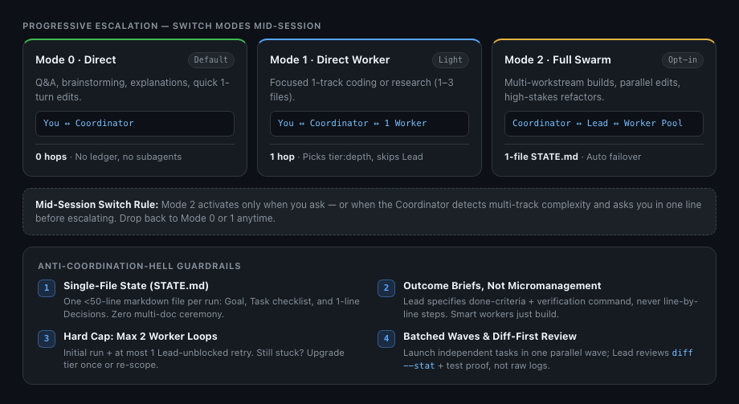

# t3-swarm

A lightweight, **three-tier multi-provider orchestration skill** for [T3 Code](https://t3.codes) — designed to give you a single, natural-language point of contact while routing planning, failover, and parallel execution across your enabled AI providers without falling into coordination hell.

- **Tier 0 — Coordinator:** Your single point of contact. Translates intent into crisp contracts, handles quota failover, and reports results in plain English.
- **Tier 1 — The Brains (Ordered Lead Failover Chain):** High-judgment models (e.g. Astra 6.2 → Fable 5.2) that plan, assign worker tiers, unblock 99% of technical issues autonomously, and review milestone diffs—never wasting flagship quota on grunt work.
- **Tier 2 — Execution Worker Pool:** Parallel, worktree-isolated workers grouped into **Heavy / Balanced / Fast** tiers and load-balanced across all your providers with anti-cannibalization.

Compatible with **`npx skills`** (`skills/<name>/SKILL.md`) and **Antigravity Plugins** (`plugin.json`).

---

## Architecture


## Operating Modes & Anti-Coordination-Hell

Swarms fail when they wrap a 2-minute bug fix in 15 minutes of planning bureaucracy. `t3-swarm` defaults to **zero overhead** and lets you move cleanly between three modes mid-session:



---

## Installation

> [!IMPORTANT]
> **Install this skill ONLY on the single harness/provider you want as your Coordinator** (for example, Antigravity, Claude Code, or Codex).
>
> Do **not** install it with `--agent '*'` across every provider. Keeping the skill on your Coordinator harness prevents unnecessary skill injection in standalone sessions on other providers.

### Install with `npx skills` (Recommended)

Pass `-g` (global) and `-a <your-coordinator-agent>`:

```bash
# Example: Use Antigravity as your Coordinator (e.g. Gemini 4 Neon)
npx skills@latest add mochahub/t3-swarm -g -a antigravity

# Example: Use Claude Code as your Coordinator
npx skills@latest add mochahub/t3-swarm -g -a claude-code

# Example: Use Codex as your Coordinator
npx skills@latest add mochahub/t3-swarm -g -a codex
```

This installs both skills from the repository:
1. **`t3-swarm`** — the main runtime Coordinator skill + zero-dependency `swarm.mjs` router CLI
2. **`t3-swarm-setup`** — interactive auto-discovery & setup wizard

### Install as an Antigravity Plugin (Optional)

If you use Antigravity and also want the optional 4-line always-on trigger rule (`rules/AGENTS.md`) that nudges your Coordinator to offer Mode 2 mid-session when a chat grows complex, clone the repo and register it in `~/.gemini/config/plugins.json`:

```json
{
  "entries": [
    { "path": "~/path/to/t3-swarm" }
  ]
}
```

### Can my Coordinator's provider ALSO be a Lead or Worker?

**Yes!** Installing `t3-swarm` on Antigravity (or Claude Code, or Codex) does **not** lock that harness into Tier 0 only.

Every delegated Lead prompt starts with `[SWARM ROLE: LEAD]` and every Worker prompt starts with `[SWARM ROLE: WORKER]`. Both `SKILL.md` and `rules/AGENTS.md` enforce a top-of-file **Role Guard**: if a child session sees either header, it ignores the Coordinator skill completely and executes strictly as a Lead or Worker.

That means if Antigravity is your Coordinator, Antigravity models (`gemini-4-neon`, `gemini-4-argon`, `gemini-3.8-flash`, etc.) can still freely serve in your Lead chain or Worker tiers alongside Codex, Claude, and Cline—with zero recursion or role confusion.

---

## Quickstart

### 1. Auto-configure from your enabled T3 providers

Open a thread on your Coordinator harness in T3 Code and say:

> *"Set up t3-swarm"*

The `t3-swarm-setup` skill calls T3's `orchestrator_capabilities`, discovers every enabled provider, model ID, and live thinking-option schema (`reasoningEffort`, `effort`, `thought_level`, etc.), proposes a Lead failover chain and Heavy / Balanced / Fast worker tiers, and writes your machine-local config to `~/.t3/swarm/config.json`.

*(If you forget this step and immediately ask to use the swarm, `t3-swarm` detects the missing config and hands off to `t3-swarm-setup` automatically.)*

### 2. Use it naturally

- **Mode 0 (Default):** Just chat normally. Quick questions and 1-turn edits stay direct—zero swarm overhead.
- **Mode 1 (Light):** *"Delegate fixing the auth token refresh test to a worker."* → Coordinator picks `tier:depth`, routes to one load-balanced worker, skips the Lead and ledger.
- **Mode 2 (Full Swarm):** *"Use the swarm to build the billing webhook pipeline with tests and docs."* → Coordinator creates a `<50`-line `STATE.md`, dispatches your Priority 1 Lead, handles mid-session failover if quota runs out, and delivers a plain-English summary.
- **Mid-session switch:** When a normal chat grows multi-track, your Coordinator asks in one line if you want to escalate to swarm mode. Say *"drop back to direct"* anytime to step down.
- **Manual quota hint:** Notice a provider running low in T3? Just say *"Codex is almost out, lead with Fable"*—the Coordinator marks a cooldown and routes cleanly without waiting for a rate-limit error.

---

## Configuration (`~/.t3/swarm/config.json`)

User configuration and runtime state live outside the installed skill so skill updates never overwrite your setup:

```text
~/.t3/swarm/
├── config.json          # Your Lead priority list, Worker tiers, and provider option maps
├── health.json          # Active provider cooldown windows & round-robin cursors
└── runs/<run-id>.md     # Single-file STATE.md per Mode 2 run (worktree-safe, zero repo noise)
```

You can also place a `.t3-swarm.json` file in any project root to override `~/.t3/swarm/config.json` for that repository.

See [`skills/t3-swarm/references/config.example.json`](skills/t3-swarm/references/config.example.json) for a full multi-provider example (Codex + Claude + Antigravity + Cline).

### How Model & Thinking Depth Selection Works

Both the Coordinator (Mode 1) and Lead (Mode 2) separate **judgment** from **plumbing**:

1. The model picks two simple knobs:
   - **Tier:** `fast` (mechanical/search/docs) · `balanced` *(default)* (features/tests) · `heavy` (hard bugs/architecture)
   - **Depth:** `low` (obvious path) · `medium` *(default)* · `high` (subtle edge cases) · `deep` *(rare)*
2. `swarm.mjs` translates `(tier, depth)` into the exact T3 `delegate_task` payload—handling cooldowns, round-robin load balancing, anti-cannibalization (`--avoid <active-lead-provider>`), per-model depth caps (`maxDepth`), and provider-specific option names (`reasoningEffort` vs `effort` vs `thought_level`).

---

## Router CLI (`swarm.mjs`)

`skills/t3-swarm/scripts/swarm.mjs` has zero external dependencies (Node 18+):

```bash
# Validate config, cooldowns, and resolved paths
node skills/t3-swarm/scripts/swarm.mjs doctor

# Show Lead priority status, active cooldowns, and recent runs
node skills/t3-swarm/scripts/swarm.mjs status

# Initialize a single-file STATE.md for a Mode 2 run
node skills/t3-swarm/scripts/swarm.mjs init "billing-webhooks" --goal "Add Stripe webhook handler + tests"

# Pick the highest-priority healthy Lead
node skills/t3-swarm/scripts/swarm.mjs pick-lead --depth high

# Pick one load-balanced worker (Mode 1)
node skills/t3-swarm/scripts/swarm.mjs pick-worker balanced:medium

# Pick a parallel wave of workers in one call, avoiding the active Lead's provider (Mode 2)
node skills/t3-swarm/scripts/swarm.mjs pick-workers heavy:high balanced:medium fast:low --avoid codex

# Mark or clear a provider cooldown
node skills/t3-swarm/scripts/swarm.mjs cooldown codex 60 --reason "quota_exhausted"
node skills/t3-swarm/scripts/swarm.mjs clear-cooldown codex
```

---

## Requirements

- [T3 Code](https://t3.codes) with two or more enabled providers (or one provider with multiple model tiers) and `canRunChildTask: true`
- **Auto** or **Full-access** runtime mode recommended so delegated Leads and Workers don't pause on approval prompts
- Node.js 18+

## License

[MIT](LICENSE)
